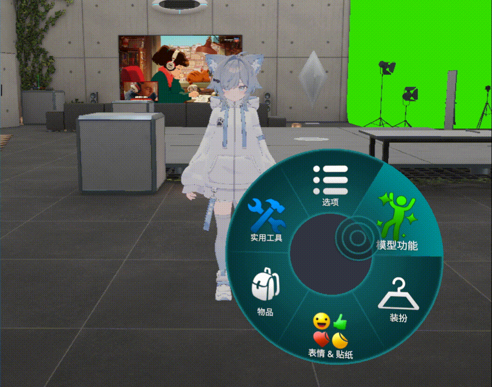
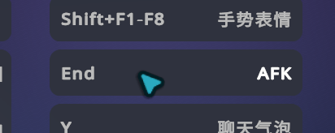
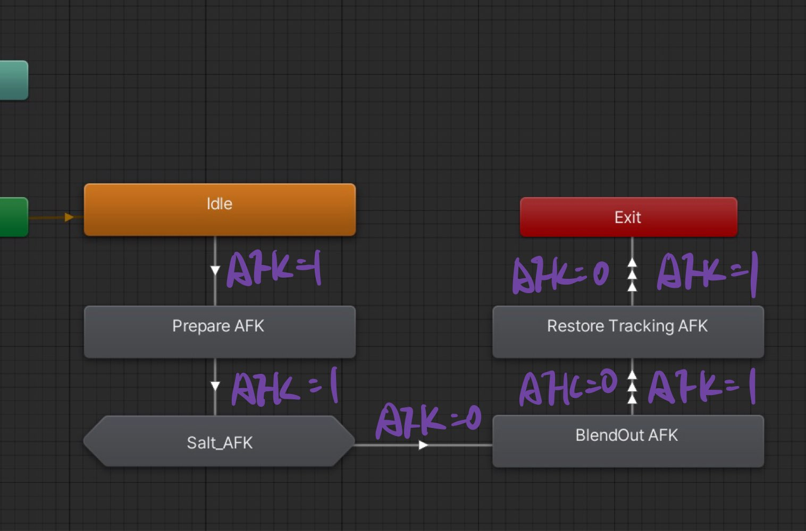
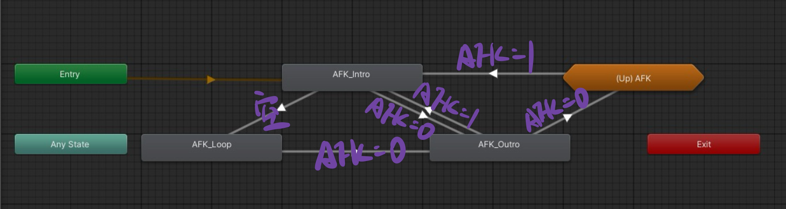
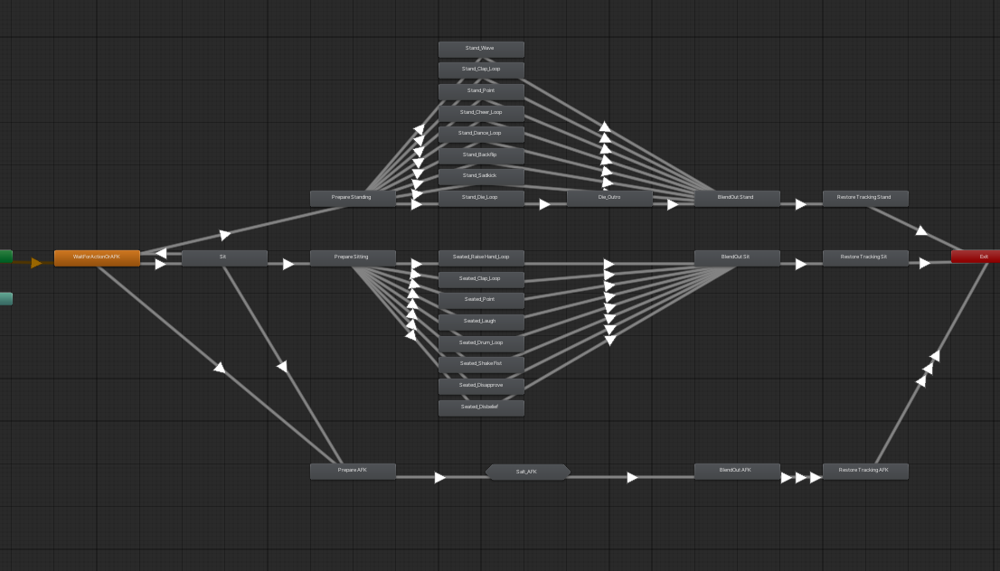
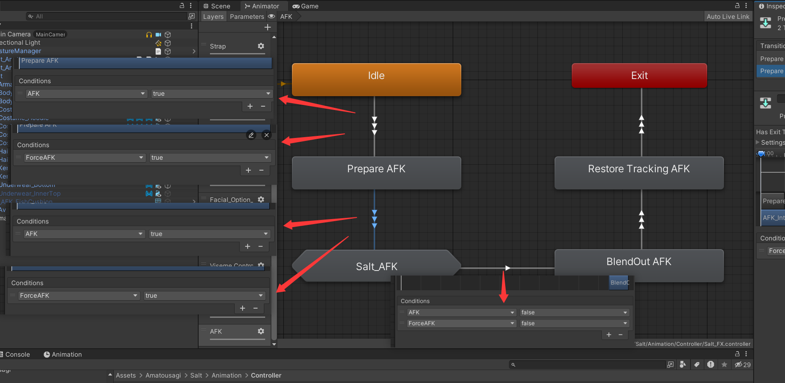
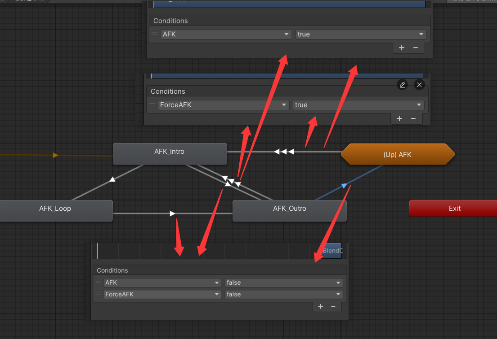

# 为何  
一般来说，VRChat 的 AFK 是客户端的自动行为，所以很少会有人真的需要做这样的一个开关。但有时或许我们想在游戏中以 AFK 的状态观察其他人，或许我们只是简单的想要这样做，于是有了这篇文章。  
按照常规的思路，我们容易想到应该去寻找控制 AFK 动画的参数：很巧，他就叫`AFK`。我们开心的用 ma 做了一个开关，却发现在游戏里刚按下开关，avatar 似乎动了一下就又恢复了平常的姿态，开关根本不能正常运作。  
  
当我们使用 `MA Menu Item` 写 `AFK` 参数时，ma 确实会自动帮我们创建这个参数，所以我们在 Unity 中测试时，它确实是能用的；但我们一旦进入游戏，情况就变了：因为 `AFK` 是`IK`同步的内置参数，官方文档中说了，内置参数是只读的，我们没办法通过 OSC 或者菜单改变它的值。确实，进入游戏后内置参数就被游戏客户端接管，它每0.1s(取决于IK情况)检查一下是否真的 AFK 了并刷新这个值，我们用菜单写进去的不会保留。而在 Gesture Manager 中则没有游戏客户端行为，所以这样的菜开关在 Unity 中是可以用的。
> 关于更多内置参数相关内容可以戳此详细了解:  
>->[creators.vrchat.com/avatars/animator-parameters](https://creators.vrchat.com/avatars/animator-parameters/) 
> 
那谁能写它呢，官方列举了三种情况：摘下头显、打开系统菜单、按下键盘上的 `End` 键。这也是开篇所说 AFK 是客户端自动行为的原因。注意第三项，官方其实给我们提供了一个方便的 AFK 开关，但可惜的是，在我目前的版本中，不知为何它没有作用。  
  
所以兜兜转转还是回到了手动做开关的路线里。
# 怎么做
那应该怎么做呢，实际上这就要看具体 Avatar 的状态机是如何做的了。AFK 听起来简单，实际上还是比衣服开关、简单的形态键调整要复杂的。我用 Salt 举例，它的AFK控制主要由三部分组成，一部分是AFK的子状态混合树，包括了全部的动作，一部分是FX控制的表情、尾巴、耳朵、鱼抱枕，它作为FX层的动画显然咖位不够改avatar的骨骼动作，于是就有了 Action 层的 AFK 部分，它负责真正让 Avatar 做出对应动作。最后还有一点小小的补充，就是 Locomotion 层中还需要让 AFK 状态不再因为受到重力影响而做出下落的姿势。  
FX 层中，在`AFK`为`True`时，首先进入`Prepare AFK` 状态，这是一个空状态，没有动画。然后进入 `Salt_AFK` 的混合树，先播放`AFK_Intro`的入睡动画，这期间如果`AFK`变成`False`就直接进入`AFK_Outro`状态，播放睡醒动画，然后退出混合树；如果保持`True`，则进入`AFK_Loop`，循环播放睡着的AFK动画。注意到退出混合树后还会以任意AFK值为条件经过一个`BlendOut AFK`状态和一个`Restore Tracking AFK`状态。前者通过WriteDefaults一个空动画来实现姿势复位，停留一帧后进入后者，把`VRC Animator Tracking Control`全部置`1`来向玩家归还IK控制权。这两个我们可以不关心。  
  
  
而 Action 层中，虽然看起来很复杂，但实际 AFK 部分（整体下方的一条）流程与 FX 层中的内容基本上是完全一样的。本文我们不必去深入研究 AFK 动作的实现原理，只需了解其生效的流程即可，因此不再深入展开。  
  
# 开始做
我们的目的，是创建一个我们可以写的参数，比如`ForceAFK`，并通过 ma 做一个开关，来让他参与AFK动画层控制，同时不影响原本的AFK。  
思路是：在所有进入AFK的判断上，只要`AFK`或者`ForceAFK`有一个为`True`（对两者进行或运算），也就意味着要么客户端发起了AFK，要么我们手动打开了AFK，我们就让它进入AFK状态。在退出AFK的判断上，只有两个参数都为`False`（对两者进行与运算），也就是首先客户端不认为现在处于AFK状态，我们也没有手动打开AFK，才能退出。Unity的动画控制器并没有什么方便的逻辑运算，我们可以用多个Transition实现或运算，用同一个Transition中写多个条件实现与运算。 
做法是：我们先在 FX Action Locomotion 三层都创建一个 `ForceAFK` 参数，并把所有条件是 AFK = True 的 Transition复制一份，并把 Condition 里的`AFK` 参数改成我们的 `ForceAFK`，这样就实现了与运算。  
然后再在所有条件为 AFK = False 的 Transition 本身的 Condition 里添加一条 ForceAFK = False 的判断来实现或运算。  
此外的Transition我们不管，比如子状态机里面空条件的依然空，最后的`BlendOut AFK`这样允许 AFK = 任何值 的我们也不修改。 
最后给 Locomotion 中进入下落状态的 Transition 添加一个 ForceAFK = False 的条件，来排除 AFK 时受重力影响下落。  

这样，我们的 ForceAFK 参数就完整的覆盖了整个 AFK 的进入和退出流程，这样终于可以用一个开关来控制是否进出 AFK 状态了。
