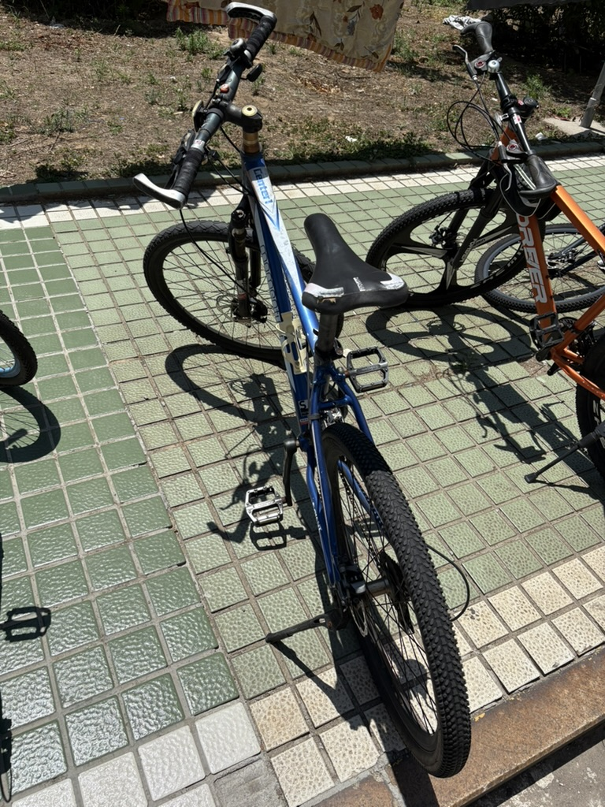
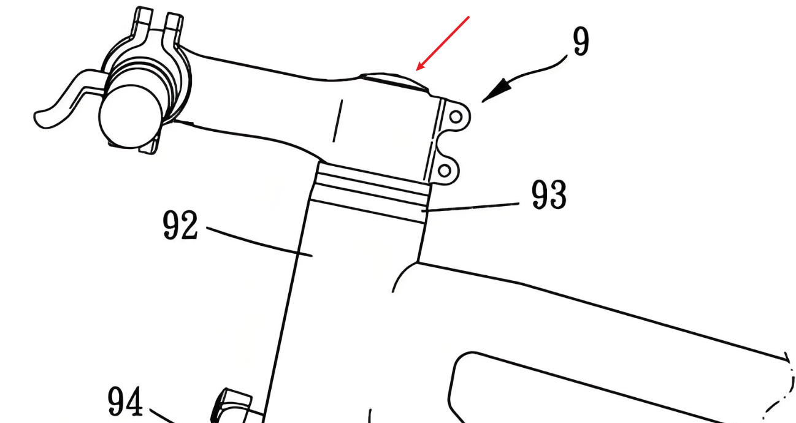
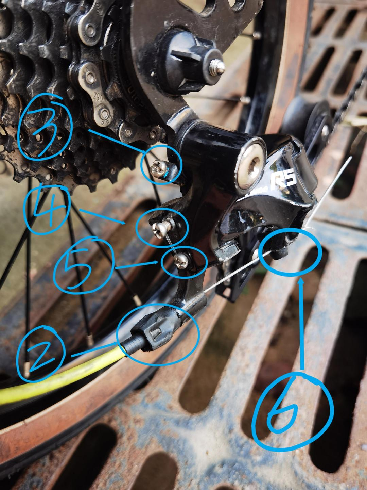
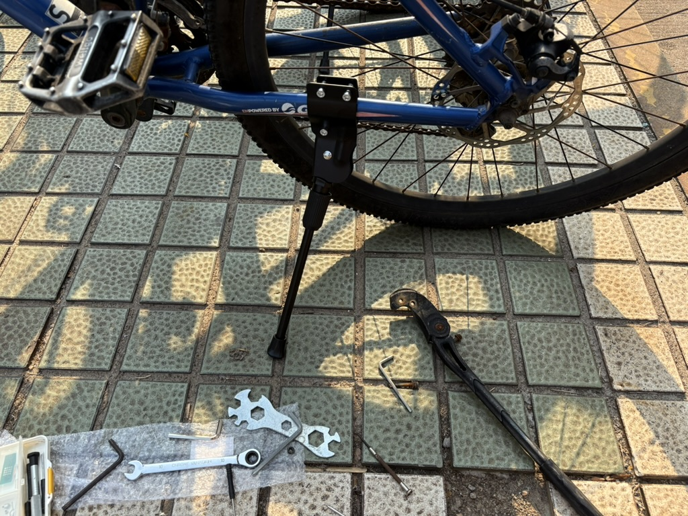
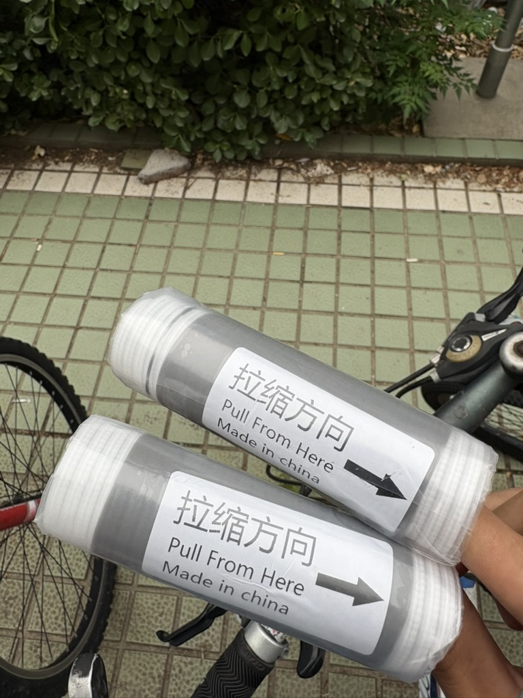
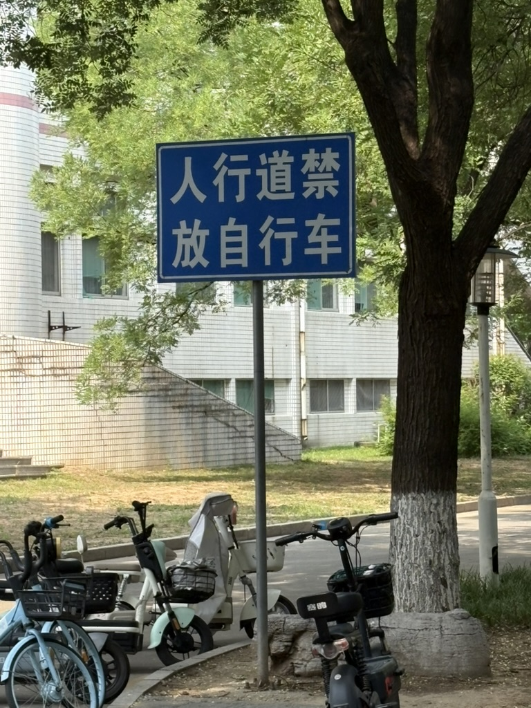

# 收(xiu)车小记
最近因为种种原因，之前一直很死宅的我在室内有点待不住了，总喜欢出去到处跑。恰逢毕业生离校，在校园集市上简单搜罗了一下，花40元从毕业生手里收了一辆二手自行车。  
当然，都这个价格了车况自然是很难描述了，因为大部分同学的车都是直接丢在室外的，经受风吹日晒雨淋，所以我也知道大概率是破破烂烂的状况。车确实能动哈，但是问题很多，大概试了几次，总结了一下：  
1. 有速度的时候捏前刹，整个前叉会剧烈抖动。  
2. 起步的时候链条剧烈跳齿跳链。  
3. 前叉避震油漏完了，几乎没阻尼。
4. 变速都坏了。（当然我没指望他好，整个学校里除了爱好者的车估计没几个能好的）
5. 脚撑很松，但是不是不能用。
6. 车把橡胶套老化，磨损很严重，能用但会弄一手碎屑。
7. 待续    

所以，买都买了，修嘛。  
  
 
  
## 前叉抖动
这个问题的原因倒是很明显了，因为捏刹车是很明显的前后抖动，很容易想到是头管的问题。很有趣的是某日实习回来的路上正好捡到一把H5规格的内六角扳手，正好能拆关于这个问题的几个螺丝。没办法就是这么巧，我都觉得巧。  
头管的结构如图，红色箭头指向的位置有一颗吊顶螺丝，这是预紧螺丝，9指向的是把立的螺丝，这两组螺丝共同把前叉拉紧。先拧松9，这个时候把立就不再和前轮联动而是可以自己转了。然后上紧红色箭头，尽可能的拉紧前叉，再拧紧9，理论上就可以把头管上紧。  
  
    
   
我这样做了，抖动确实有显著的缓解，但无法完全解决。靠用力拧红色的预紧螺丝是没有用的，因为这里里面的结构只是一个内侧带有螺纹、外侧带齿并且焊接在管里的金属片，一般称为花心。正因为他只是一片金属，所以它并不能受很大的力，只是一个预紧螺丝。  
那是怎么回事呢，难道是轴承有问题吗，我把头管拆开检查了碗组，似乎并没有很显著的磨损，轴承也没缺珠；但是以我的水平我也只能认为是磨损的问题。一套普通的碗组要几十块钱，想了想算了，这样也能用。  
## 关于跳齿跳链
这个问题仅出现在刚起步的时候，我最开始很自然地以为是飞轮跳档，也就是链条在后飞轮不同的档位上跳。但经过观察之后发现好像并不是，因为每次跳齿发生之后链条总在最小飞轮上（也就是最高挡上）。所以又以为是后花鼓棘轮磨损导致受到比较大的扭矩时咬合不足导致跳齿。这个我修不了，没工具，配件又贵，所以打算不管了。  
但是，我偶然发现倒着走链条的时候有时会把后拨往回收，这时候链条会离开后拨导向轮（靠近飞轮的小导轮），并且飞轮上的链条会往大飞轮上走。毕竟变速装置早就烂完了，本着死马当活马医的态度直接把后拨两个方向的限位（图上4和5）都拧到底，这样理论上导向轮就不会动了。真的就不怎么跳了，那太好了，不用换花鼓简直是天大的好消息。不过是这样的情况话大概未来某一天链条也得换了。  
图是网上找的，我的车比这要破很多。  
  

## 修避震...这个不修
避震漏油这我也修不了，本身是可以调节预应力的避震，现在拧他的调节旋钮已经完全没用了。好在不影响骑，不管了。实在不行就把前叉锁死，毕竟在铺装路面骑行根本不需要避震，有避震还卸力，何苦修他折磨自己嘛。  
## 变速这个也暂时不修
这套变速机构显然是没什么维修价值了，前拨已经完全动不了了，后拨虽然松松的但是变速线也拉不动它。目前的想法是等有机会换个蓝图A3半套小套吧，也就是右指拨、后拨这一套，因为一直卡在大盘小飞的最高挡起步太痛苦了。不过不换也行，主要是这一小套能顶两台这车的价格了，淋坏了我也心疼。  
## 换脚撑
旧的脚撑虽然能撑得住车子，打上去之后也不会掉下来，但太松了，打下来也会有很大幅度晃动。而且它的旋转部是铆接的，我拆下来看了看没法修，直接丢掉了。花12块多一点点买了一个新的，舒服多了。   
这个边撑给了两个橡胶垫子，是直接像这样装在车驾上的，用起来很方便。图片上装得有点靠前了，骑起来和脚有点冲突，后来又往后调了一点。   
  
  
  
## 关于车把橡胶套
老化之后总是掉碎屑这个还是挺膈应，有的时候还会把手弄得黏糊糊的。但是我想我就是换了新的，大概率时间长了也还得老化吧。所以本来是打算搁置的，后来忽然看到了电缆做接头用的冷缩管这种神奇玩意，于是花不到10元买了两个短短的。  
把副把拆掉，就可以直接拽掉旧的换上冷缩管了。缺点是它薄薄的，手握车把会感觉车把很细；但其实也还好，因为是硅胶材质摩擦力足够。还有就是我买的有点短了，只能覆盖大概70%的把手长度。打算再买个长点的直接套在上面。  
    
   
   
## 小结
虽然说其实修之前也能骑，但经过这一番折腾之后确实舒适了不少。到目前为止花了60出头的价格，可能等到忍不住之后再换个变速小套吧。  
这台车总体的稳定性蛮好，稍微有点速度就可以双手脱把，有点出乎我意料的。总的来说感觉很值。对我这种在家里待不住的人来说有个代步工具真的能很大程度上提高生活乐趣。  
  
