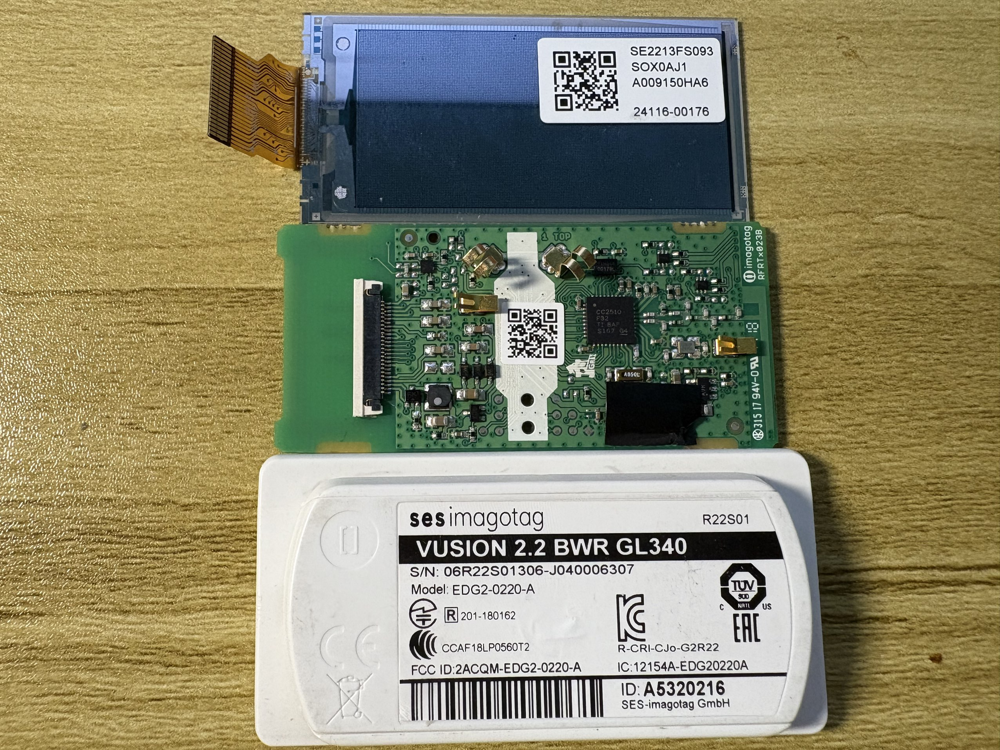
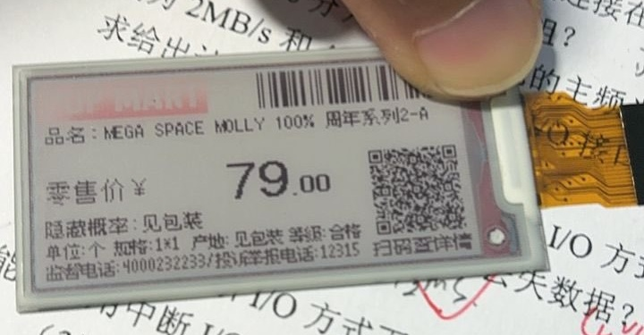
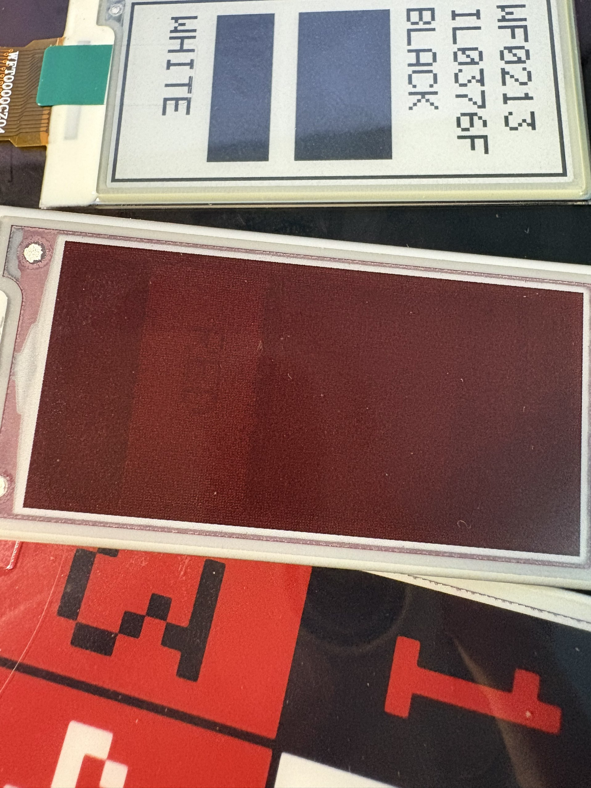
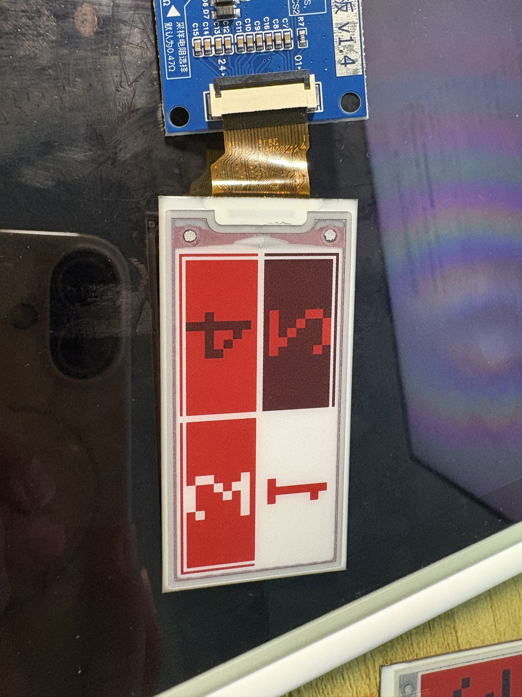

前阵子在拼多多刷到低价处理的一些墨水瓶价签，不包资料。按照我的经验来说，不包资料的便宜屏幕你最好早点买，一旦有闲人逆向出来了就没有当初的价格了（事实证明是错的）。再结合墨水屏本身就是很贵的东西，于是我花不到10元买了一个看起来还不错的。
## 拆  
这个屏幕甚至是预售，付款大概半个月左右才到手。
  
到手拆开之后发现，这是 SES-imagotag 的电子价签，型号是 `VUSION 2.2 BWR GL340`。它是 2018 年 41 周生产的，距今已经接近10年。使用2个 cr2450 电池并联供电（到我手时已经接近0v），主控是 CC2510，德州仪器的芯片，屏幕是 `SE2213FS093`，用 24pin 的软排线连接到主板。而这个面板在全世界范围内真的找不到资料，这就不太符合我的预期了。
  
因为墨水屏是不能直接被3v3或者5v电平驱动的，而驱动部分就在这个电子价签的板子上。要研究明白这个mcu，至少需要多通道的逻辑分析仪，而要借用这块板子的驱动电路也非常麻烦。所以我和 AI 大战一番之后得出的结论是先搁置。
## 驱动板
后来的某一天，又是刷 pdd，发现有墨水屏驱动板这种东西，而且他还没写明支持的屏幕型号，只写了个“微雪方案”。这让我意识到，或许这驱动板也存在什么**一招鲜吃遍天**的通用方案？  
我先去找本家，搜索了微雪的驱动板，发现人家微雪是自己有屏幕的。但我意外的发现确实有人做通用性很强的驱动板，商品链接里写，只要是 24pin 大概率能用。  
这块驱动板7元不到，但却要比较贵的运费。点进店铺发现这是一个电子爱好者的小店，里面也卖一些墨水屏，像我这样的 2.13 寸的库存屏或者拆机屏只需要 2-5 元。顿时感觉这价签有些亏了。 
为了不让他全亏进去，我还是买了驱动板，还在店里买了两块屏幕，一个黑白的2.13寸和一个黑白红的2.66寸。  
## 试试
因为这块屏幕的型号 `SE2213FS093` 实在找不到资料，而 `E2213FS091` 能找到，于是我就先按照后者的情况自己造轮子写 spi 驱动尝试。简单试了一下发现真的能刷，但颜色和 SSD1680 驱动里相反。此外还发现一个问题，是似乎这块屏幕并不能显示黑色，显示出的黑色都是黑色叠加红色的一种感觉，或是黑色刷新不全的一种感觉。  
难道就该是这样吗，我拿出了我买的另外两块屏幕，绘制了一些测试图片。发现本不该如此啊，他们都是能显示纯正的黑的。
  
而且这块屏幕的坐标还有神奇的反转

 