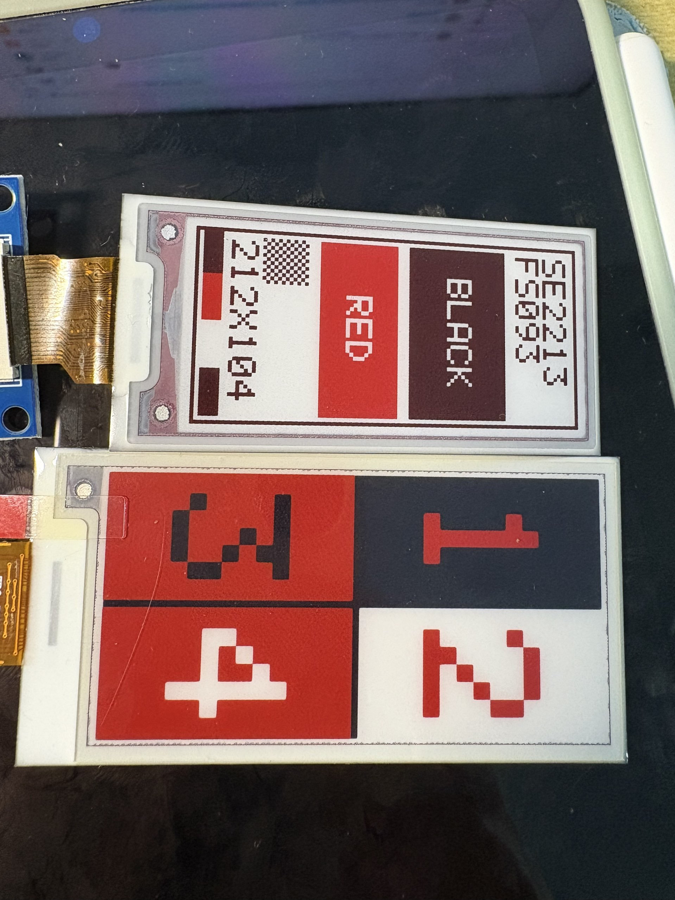
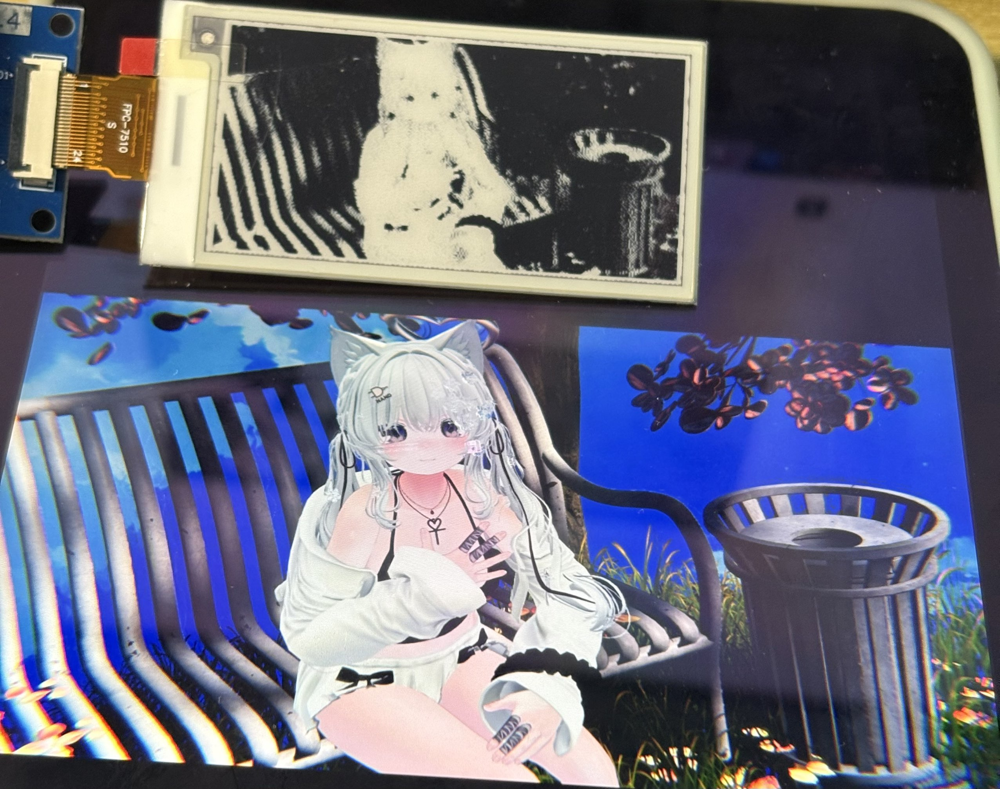
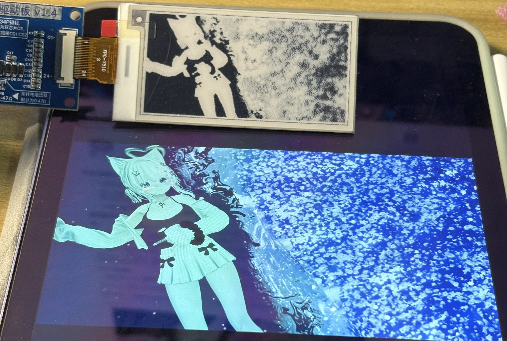

前阵子在拼多多刷到低价处理的一些墨水瓶价签，不包资料。按照我的经验来说，不包资料的便宜屏幕你最好早点买，一旦有闲人逆向出来了就没有当初的价格了（事实证明是错的）。再结合墨水屏本身就是很贵的东西，于是我花不到10元买了一个看起来还不错的。
## 拆  
这个屏幕甚至是预售，付款大概半个月左右才到手。
  
到手拆开之后发现，这是 SES-imagotag 的电子价签，型号是 `VUSION 2.2 BWR GL340`。它是 2018 年 41 周生产的，距今已经接近10年。使用2个 cr2450 电池并联供电（到我手时已经接近0v），主控是 CC2510，德州仪器的芯片，屏幕是 `SE2213FS093`，用 24pin 的软排线连接到主板。而这个面板在全世界范围内真的找不到资料，这就不太符合我的预期了。
  
因为墨水屏是不能直接被3v3或者5v电平驱动的，而驱动部分就在这个电子价签的板子上。要研究明白这个mcu，至少需要多通道的逻辑分析仪，而要借用这块板子的驱动电路也非常麻烦。所以我和 AI 大战一番之后得出的结论是先搁置。
## 驱动板
后来的某一天，又是刷 pdd，发现有墨水屏驱动板这种东西，而且他还没写明支持的屏幕型号，只写了个“微雪方案”。这让我意识到，或许这驱动板也存在什么**一招鲜吃遍天**的通用方案？  
我先去找本家，搜索了微雪的驱动板，发现人家微雪是自己有屏幕的。但我意外的发现确实有人做通用性很强的驱动板，商品链接里写，只要是 24pin 大概率能用。  
这块驱动板7元不到，但却要比较贵的运费。点进店铺发现这是一个电子爱好者的小店，里面也卖一些墨水屏，像我这样的 2.13 寸的库存屏或者拆机屏只需要 2-5 元。顿时感觉这价签有些亏了。 
为了不让他全亏进去，我还是买了驱动板，还在店里买了两块屏幕，一个黑白的2.13寸和一个黑白红的2.66寸。  
## 试试
因为这块屏幕的型号 `SE2213FS093` 实在找不到资料，而 `E2213FS091` 能找到，于是我就先按照后者的情况自己造轮子写 spi 驱动尝试。简单试了一下发现真的能刷，但也是遇到了不少问题，踩了不少坑。


### 问题1：坐标是竖着走的

我一开始让AI按 SSD1680 的经验，把图当成 212 x 104 高的横图，按行写进去。结果就是上面那样：本来画的是2x2的四块，各写一个数字，刷出来是整个转了 90° ，数字还是镜像的。原来这块屏的显存是竖着存的：

```text
x = 竖直方向，从上到下，0 .. 211
y = 水平方向，从左到右，0 .. 103

index = x * 13 + (y >> 3)
mask  = 1 << (7 - (y & 7))
一帧 = 212 * 13 = 2756 字节
```

它的一“行”只有 104 个像素，也就是 13 个字节，一共却有 212 行，小学数学老师气疯了。所以横屏直接写就等于把图顺时针转了 90° 再左右镜像了。所以把画图的逻辑坐标定成竖着的 104×212，跟屏实际的方向一致，只在写进显存的时候交换一下：

```cpp
uint32_t i = row * 13 + (col >> 3);
uint8_t  m = 0x80 >> (col & 7);
```

`row` 是竖直方向 0 到 211，`col` 是水平方向 0 到 103。忽然发现不止小学数学老师，线代老师也气疯了。

除了方向，颜色和 SSD1680 也是反的：`0x10` 里 1 是黑、0 是白；`0x13` 里 1 是红，而且红色会盖住黑白。BUSY 居然也是反的，高电平是空闲，低电平才是忙，照着 SSD1680 写 `while (!BUSY)` 就会一直闲，卡死在里面。  
不愧是定制屏啊，除了一样的全都不一样（x）。

初始化照 PDI 官方的 `COG_initial()` 来写：

```cpp
send(0x00, {0x0E});        // 软复位
send(0xE5, {0x19});        // 手动写温度 25 °C
send(0xE0, {0x02});        // 主动温度
send(0x00, {0xCF, 0x8D});  // PSR
```

上面`0x00` 写两次是有意的，这其中`0x0E` 是软复位子命令，`0xCF 0x8D` 才是面板配置。刷新是 `0x10`、`0x13` 发两个平面，然后 `0x04` 开电、`0x12` 刷新、`0x02` 关电，每一步都是等 BUSY 变高结束。

实测（3.3 V、25 °C、软件 SPI）：

| 操作          | 时间            |
| ------------- | --------------- |
| 复位 + 软复位 | 各 20 ms 内     |
| 开电 `0x04`   | 41 ms           |
| 刷新，无红    | 16.98 s         |
| 刷新，有红    | 22.65 ~ 22.73 s |
| 关电 `0x02`   | 20 ms 内        |

此外这块屏还不支持局部刷新，`0x50` 对这块屏没用，每次都是全屏。所以想让它当个时钟或者天气牌是有点难了，有点可惜。


### 问题2：黑不是黑
似乎这块屏幕并不能显示黑色，显示出的黑色都是黑色叠加红色的一种感觉，或是黑色刷新不全的一种感觉。  
难道就该是这样吗，我拿出了我买的另外两块屏幕，绘制了一些测试图片。发现本不该如此啊，他们都是能显示纯正的黑的。



先前提到了，这块面板 `SE2213FS093` 完全查不到资料，但是 PDI 的 `E2213FS091` 能查到，两者都是 2.13 寸、212×104、黑红白三色、Spectra Red 1.2 膜片，简直一模一样。那基本可以确定，PDI 给 ESL 客户的丝印多一个 S 前缀（例如`SE2266JS0C2` 对应 `E2266JS0C2`），所以这个 `093` 大概就是 SES 的定制批次和定制 OTP 波形。它用的是 PDI 自己的 iTC，微雪和 GxEPD2 这些通用驱动都用不了，命令只能对着上面提到 091 的资料和 PDI 官方驱动一条条对了。还好有AI，干这种活已经是特别轻松。

我最先怀疑是定制屏幕在这一点也有一些区别，和AI一起把极性、坐标、初始化试来试去都没有结果。毕竟白和红都是对的。又注意到驱动板上的采样电阻，板上印着“默认为 0.47Ω”，可以切换到 3Ω ，然而 PDI 参考电路就是 0.47Ω。后来想是不是温度补偿的问题，把温度寄存器改成 5 °C，刷新时间从 17 秒涨到 32 秒，说明他这个波形确实是换了，但颜色基本上一点没变。  
最后 AI 在 PDI 的规格书里看到：

> Reddish on the edge of black image is normal at high temperature.

意思是说黑色图像的边缘高温时会发红，那难道说这个酒红色是正常的，只是这个面板红得比较彻底？但整片都是酒红，这正常吗？我觉得不正常啊，但会不会是老化了呢，我觉得或许有可能吧。但也不排除有可能是驱动的问题。  


> AI 注：三色电泳里黑粒子和红粒子都带正电，刷黑时的 +15 V 会把红色粒子也一起带上来。好的波形中间需要一个「纯化红粒子」的阶段，而这段在 COG 的 OTP 里，主机改不了。所以这个问题软件无解，只能换批次或者换型号。


### 问题3：红色残影

在调上面那个问题的时候发现，这个面板它画过红色之后，下一帧就算全白，红色也只是被盖住；再画黑色，之前那片红又会在原来的位置浮出来。
  
只刷一次白是不太行。我试了几次，应该得连续刷 3 次全白才能彻底清掉，代价是每帧多花 51 秒左右。当然这只有涉及红色的时候才有必要，纯黑白的页面刷一次就够了。

## 其他的屏幕

买驱动板的时候还买了一块 2.66 寸的屏，这个是 DKE 的 `DEPG0266RHS752FICP`，296×152，SSD1680 控制器。试试。  
不得不说确实是相当通用的驱动板啊。24pin 直接插就能用。

### 真值表

这块屏有两个平面寄存器 `0x24` 和 `0x26`，实测出来是这样：

| `0x24` | `0x26` | 显示 |
| ------ | ------ | ---- |
| `0x00` | `0x00` | 黑   |
| `0xFF` | `0x00` | 白   |
| `0x00` | `0xFF` | 红   |
| `0xFF` | `0xFF` | 红   |

也就是说 `0x24` 的 bit1 是白、bit0 是黑，不是常见的 1=黑；`0x26` 的 bit1 是红，而且红色优先级更高。

### 初始化

初始化是 GxEPD2 库里的 `GxEPD2_266c`（GDEY0266Z90）同样照着写：

```cpp
send(0x12);                          // 软复位
send(0x01, {0x27, 0x01, 0x00});      // 296 行
send(0x11, {0x03});                  // X+, Y+
send(0x3C, {0x05});                  // 边框波形
send(0x18, {0x80});                  // 内部温度传感器
send(0x21, {0x00, 0x80});            // 从 OTP 载入 LUT

// RAM 窗口
send(0x44, {0x00, 0x12});
send(0x45, {0x00, 0x00, 0x27, 0x01});
send(0x4E, {0x00});
send(0x4F, {0x00, 0x00});

send(0x24, bw, 5624);                // bit1 = 白
send(0x26, rd, 5624);                // bit1 = 红

send(0x22, {0xF7});                  // 刷新
send(0x20);
```

相比那个拆机屏，这个 BUSY 也反过来了，拆机屏是高电平有效，这块是高电平忙。

这个刷新一次 14.05 秒，比拆机屏快不少，而且黑色是正常的黑，没有酒红的问题。这块屏的显存也是行优先，一行 152 像素、19 字节、一共 296 行；它是竖着的 152×296，横图先旋转 90° 再按行写就行了。  
让他显示几张图片看看：





这个分辨率和灰度（好吧其实没有灰度）还是太局限了，不适合看图啊。
## 最后
这个拆机屏实在算不上正常运行了，虽然他作为一个可观测宇宙内找不到任何资料的屏幕我能让他显示出图像就已经不错了，但如果黑色能显示纯正的黑就好了。不知道究竟是硬件问题还是驱动问题，但只能再一次暂时先搁置了。
### 参考资料：

- PDI `E2213FS091` 规格书：<https://www.vniva.com/pdf-c3/E2213FS091.pdf>
- PDI 官方驱动：<https://github.com/PervasiveDisplays/PDLS_Basic>
- PDI BWR 全局刷新说明：<https://docs.pervasivedisplays.com/knowledge/Archives/Hardware/Screens/small-epds/BWR-globalonly.html>
- PDI 的 GxEPD2 分支：<https://github.com/shanislav/GxEPD2_PervasiveDisplays>
- SES-imagotag 逆向：<https://github.com/TenOfNine/imagotag-vusion-esl-reverse-engineering>

 